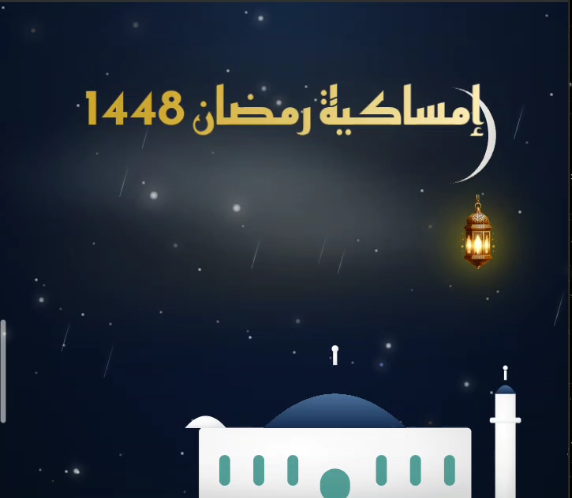
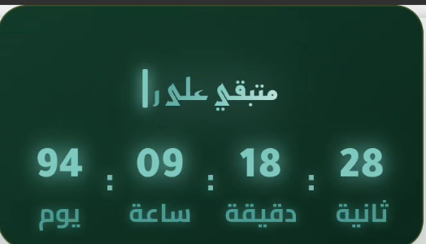

# Ramadan Emsakiah 1448 | إمساكية رمضان 1448

تطبيق إسلامي أنيق لعرض إمساكية شهر رمضان المبارك 1448هـ، مع تصميم ليلي ساحر وفانوس ذهبي متأرجح.

## ✨ الميزات (Features)
- 🕌 **خلفية ليلية ساحرة**: مسجد أبيض، هلال متوهج، نجوم متلألئة، وسحب متحركة.
- 🏮 **فانوس ذهبي ملكي**: يتأرجح بانسيابية ويتوهج بلون ذهبي.
- ⏳ **عداد تنازلي دقيق**: يعرض الأيام، الساعات، الدقائق، والثواني المتبقية لشهر رمضان.
- 📅 **تقويم كامل**: يعرض مواقيت الصلاة (الفجر، الظهر، العصر، المغرب، العشاء) لكل يوم.
- 🌙 **واجهة مستخدم حديثة**: تصميم متجاوب (Responsive) يعمل على جميع الهواتف.

## 📱 لقطات الشاشة (Screenshots)

  
  
  
  
  

## ⚙️ التقنيات المستخدمة (Tech Stack)
- HTML5, CSS3, JavaScript (Vanilla)
- Capacitor (لتحويل التطبيق إلى Android)
- GitHub Actions (اختياري للـ CI/CD)

## 👨‍💻 المطور (Developer)
- **MuslimCode** - [GitHub](https://github.com/Devloperjava)
